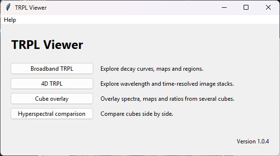
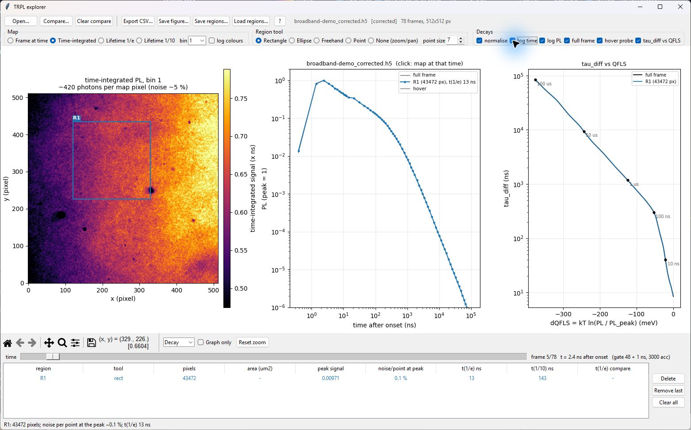
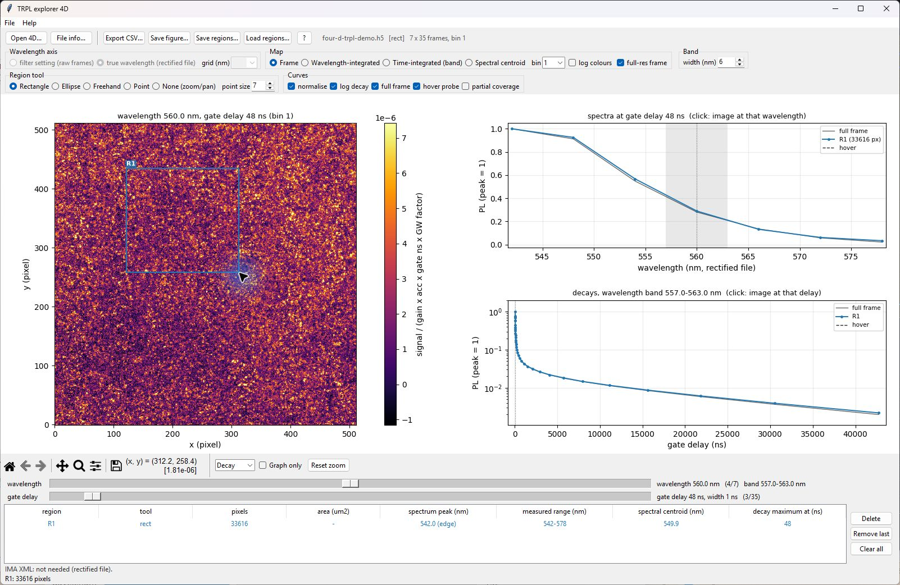
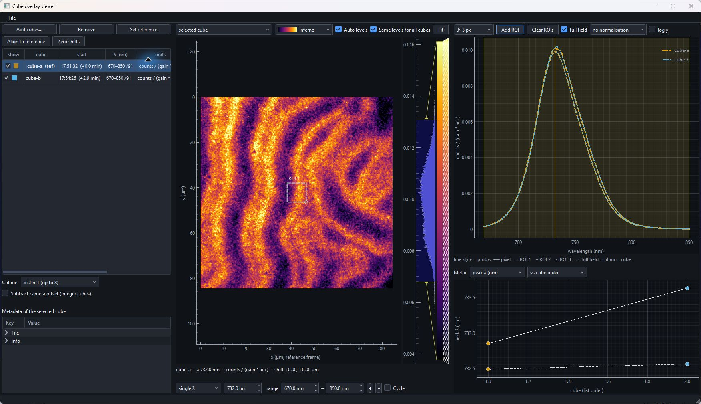
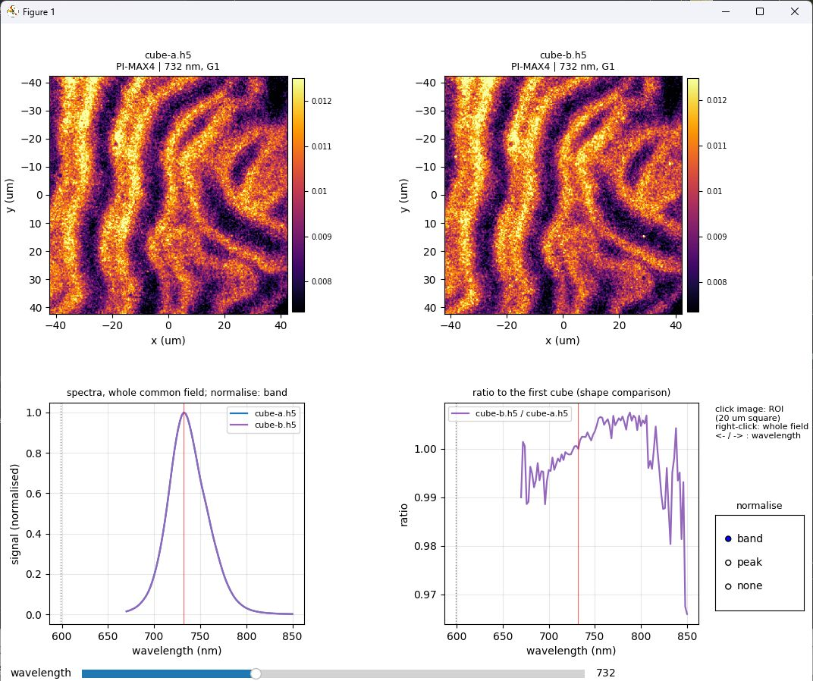

# TRPL Viewer

Open and inspect existing time-resolved photoluminescence and hyperspectral HDF5 files on Windows. The viewers read measurement files and save exports such as CSV curves, plots, and regions separately.

## Install and update

Download `TRPL-Viewer-Setup-<version>-win-x64.exe`, run it, and open **TRPL Viewer** from the Windows Start menu. The installer includes Python and the viewing libraries. [Latest Windows release](https://github.com/dubajicmilos/TRPL-Viewer/releases/latest)

Use **Help → Check for updates** to check for newer public releases. While the preview repository is private, sign in to GitHub to download an update from Releases. Run the newer installer to upgrade. Viewing local files works offline.

## Broadband TRPL

1. Choose **Broadband TRPL** and open a raw, corrected, or stitched broadband `.h5` file.
2. Choose **Rectangle** and drag over the map to plot a region's decay. The table shows its decay times. Click the decay curve to display the nearest measured frame.
3. Use **Compare…** to overlay a second run with the same image dimensions. Use **Export CSV…** to save the curves.

## 4D TRPL

1. Choose **4D TRPL** and open a raw or rectified 4D `.h5` file. For raw files, use **File → Choose IMA XML…** if you need to supply wavelength calibration.
2. Use the **wavelength** and **gate delay** sliders to browse the stack. Click the spectrum to choose a wavelength, or click the decay to choose a delay. The shaded band in the spectrum is the wavelength range used for the decay.
3. Draw a region on the image to compare its spectrum and decay with the full field.

### Zoom and inspect TRPL graphs

Scroll over a graph to zoom. Hold **Shift** to zoom horizontally or **Ctrl** to zoom vertically. The hand tool pans, and the magnifier lets you drag out a zoom box. Pick a plot in the menu below the graphs and use **Graph only** to fill the plot area. **Reset zoom** restores the full range. Hover near a measured point to read its values.

## Cube overlay

1. Choose **Cube overlay** and use **Add cubes…** or drag `.h5` files into the window.
2. Select a cube and click **Set reference** to choose the common image frame. Use **Align to reference** to register the other cubes when needed.
3. Click a point on the image or use **Add ROI** and drag the region. The spectra and selected metric update for the displayed cubes.

## Hyperspectral comparison

1. Choose **Hyperspectral comparison** and select two or more PHySpec-layout `.h5` cubes. The first cube is the reference.
2. Move the wavelength slider to browse the images together. Click an image to compare the same region across cubes. Right-click an image to return to the whole field.
3. Read the spectra on the lower left and the ratios to the reference on the lower right. Select **band**, **peak**, or **none** to change the normalisation.

The screenshots use measured data with simplified filenames.
